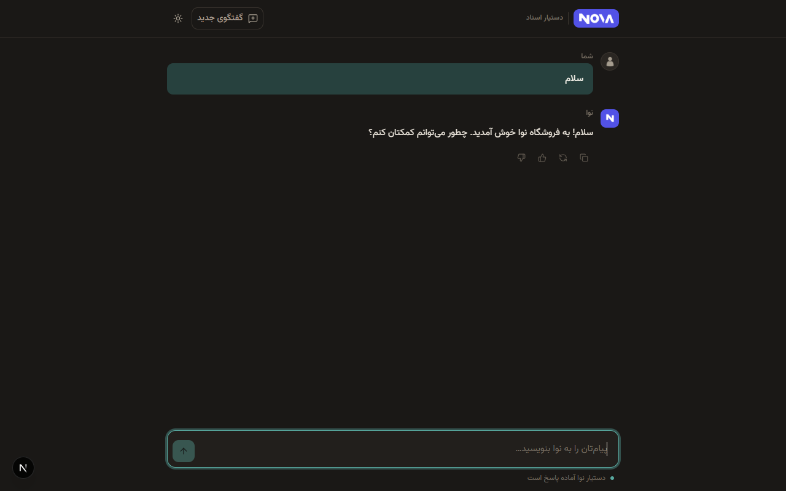
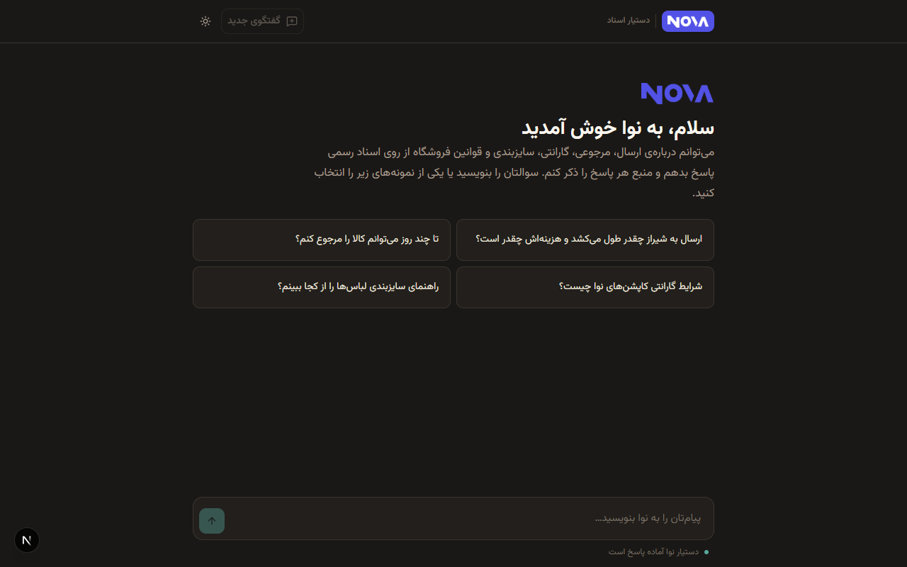
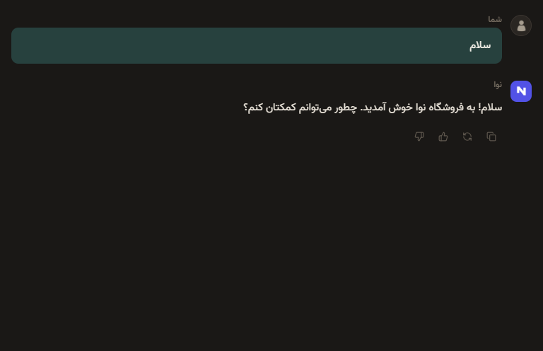
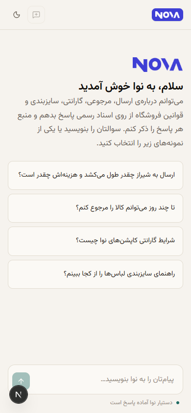

# 🤖 Nova — Persian RAG Customer Support Agent

**Nova (نوا)** is a production-grade, Persian-first Retrieval-Augmented Generation (RAG) assistant for e-commerce, built with **Next.js 16 (App Router + Turbopack)**, the **Vercel AI SDK**, **Google Gemini 2.5**, and **Supabase pgvector**.
It answers customer inquiries about shipping, returns, warranties, sizing, and policies strictly from store documentation, executing tool-driven semantic search and citing authoritative sources on every response.

> ⚡ **Portfolio-Level AI Project** – Showcasing senior-level work in **RAG pipeline design, embedding chunking strategies, Persian RTL interface architecture, agentic tool calling, and evaluation harnesses**.

[](#)

---

## 🛠 Tech Stack


---

## ✨ Key Features

- 🧠 **Agentic RAG Pipeline** – Gemini autonomously invokes `search_knowledge`, `list_sources`, and `read_document` tools with up to 6 iterative steps to retrieve context before generating an answer
- 📚 **Strict Grounding & Hallucination Defense** – Answers strictly adhere to ingested markdown documents (`data/*.md`); queries outside the knowledge base receive an explicit, honest "information not found" response
- 📌 **Interactive Source Citations** – Inline citation chips `[۱]` dynamically resolve to document chips under each answer, rendering exact source references
- 🎨 **Persian-First RTL Design System** – Custom warm palette, optical text balancing, self-hosted Vazirmatn font, and zero-flash dark mode (default)
- ⚡ **Real-Time Streaming** – Token-by-token streaming UI with animated thinking indicator and live tool execution chips
- 📜 **Auto-Follow Smart Scroll** – Automatically sticks to the latest streaming token when at the bottom; gracefully pauses when the user scrolls up to review history
- 🛡️ **Production-Grade Rate Limiting** – Dual sliding-window IP rate limiting (10 req/min + 50 req/day) backed by Upstash Redis, failing open gracefully if Redis is unconfigured
- 🌗 **Zero-Flash Dark / Light Theme** – Pre-paint inline script applies theme before hydration, with dark mode as the default experience
- 🧪 **Automated Evaluation Suite** – Built-in test harness (`evals/run.ts`) executing multi-step factual assertions and pacing requests to prevent rate limits
- 📱 **Responsive & Mobile Ready** – Verified responsive layout down to 390px viewports with touch-friendly controls and sticky composer

---

## 📸 Visual Preview

<div align="center">

### 🌗 Dark Mode (Default)

*Full conversation view showing user message, agent reply, interactive citation chips, and active assistant status.*



---

### ☀️ Light Mode & Welcome Screen

*Empty state with suggested quick-prompt cards, NOVA brand mark, and clean RTL typography.*



---

### 📑 Source Citations & Tool Execution

*Close-up of tool execution chips (`جست‌وجو در اسناد`) and resolved source chips under the assistant answer.*



---

### 📱 Mobile Experience

*Responsive 390px layout with adaptive brand header, compact action buttons, and touch-optimized composer.*



---

### 🔗 Live Demo

**[Live Demo — Link Coming Soon](#)**

</div>

---

## 🗂 Project Structure

| Path | Description |
| --- | --- |
| `src/app/api/chat/route.ts` | Edge-ready streaming chat endpoint orchestrating rate-limiting, message trimming, and Gemini stream |
| `src/app/globals.css` | Complete Tailwind v4 design system, color tokens, RTL resets, animations, and typography rules |
| `src/app/layout.tsx` | Root layout with pre-hydration dark-theme script, metadata, and viewport configuration |
| `src/app/page.tsx` | Main page wrapping the Chat client component in a Suspense boundary |
| `src/components/Chat` | Core chat UI component handling stream lifecycle, smart scroll, Markdown, and theme toggling |
| `src/lib/chunk.ts` | Paragraph-aware markdown text chunker with configurable overlap |
| `src/lib/embed.ts` | Google `gemini-embedding-001` client with 768-dim vectors and batching |
| `src/lib/model.ts` | Gemini model configuration and dynamic thinking budget control |
| `src/lib/prompt.ts` | Grounded system instructions enforcing tone, boundaries, and citation format |
| `src/lib/rag.ts` | Supabase RPC vector match query runner (`match_chunks`) |
| `src/lib/ratelimit.ts` | Upstash Redis sliding-window rate limiters with graceful fallback |
| `src/lib/supabase.ts` | Supabase client singleton |
| `src/lib/tools.ts` | Vercel AI SDK tool definitions for agent document search and retrieval |
| `data/*.md` | Knowledge base documents (company, shipping, returns, sizing, warranty, payment, FAQ) |
| `scripts/ingest.ts` | CLI script to chunk, embed, and upsert markdown docs into Supabase pgvector |
| `evals/run.ts` | Automated accuracy and hallucination benchmark suite |
| `public/brand` | Brand masks, wordmark, monogram, and persona avatar assets |

---

## ⚙️ How It Works

```
┌─────────────────┐       ┌────────────────────────┐       ┌──────────────────────┐
│  User Question  │ ────> │  Next.js /api/chat     │ ────> │  Gemini Agent Loop   │
└─────────────────┘       └────────────────────────┘       └──────────┬───────────┘
                                                                      │
                                    ┌─────────────────────────────────┴───────────────────┐
                                    │ Tool Call: search_knowledge(query)                  │
                                    ▼                                                     ▼
                         ┌───────────────────────┐                            ┌───────────────────────┐
                         │ gemini-embedding-001  │                            │ Supabase pgvector     │
                         │ (768-dim query vec)   │ ─────────────────────────> │ match_chunks RPC      │
                         └───────────────────────┘                            └──────────┬────────────┘
                                                                                         │
                                    ┌────────────────────────────────────────────────────┘
                                    ▼
                         ┌───────────────────────┐
                         │ Stream Markdown +     │ ────> Client UI (Auto-Scroll & Citations)
                         │ Source Citations      │
                         └───────────────────────┘
```

1. **Ingestion (`scripts/ingest.ts`)** – Reads markdown files from `data/`, splits text with paragraph preservation and overlap, generates 768-dimensional embeddings via Google `gemini-embedding-001`, and upserts into Supabase `chunks`.
2. **User Request (`/api/chat`)** – Enforces Upstash sliding-window rate limits, trims conversational history, and initiates an agentic loop with Gemini.
3. **Agent Loop (`src/lib/tools.ts`)** – Gemini analyzes the inquiry, determines whether document retrieval is required, calls `search_knowledge`, and inspects cosine similarity scores.
4. **Streaming Response** – Answer streams to the client with `useChat`, rendering sanitized Markdown, code copy buttons, interactive citation badges `[۱]`, and resolved source chips.

---

## 🚀 Getting Started

### 1. Prerequisites

- **Node.js** 20+ and **npm**
- **Google Gemini API Key** (via Google AI Studio)
- **Supabase project** with the `pgvector` extension enabled
- *(Optional)* **Upstash Redis** for production rate limiting

### 2. Installation

```bash
git clone https://github.com/condev-dev/nova-agent.git
cd nova-agent
npm install
```

### 3. Environment Variables

Create `.env.local` based on `.env.example`:

```bash
cp .env.example .env.local
```

Fill in the required keys:

```ini
GOOGLE_GENERATIVE_AI_API_KEY=your_gemini_api_key
MODEL_ID=gemini-2.5-flash

NEXT_PUBLIC_SUPABASE_URL=https://your-project.supabase.co
SUPABASE_SERVICE_ROLE_KEY=your_service_role_key

UPSTASH_REDIS_REST_URL=https://your-redis.upstash.io
UPSTASH_REDIS_REST_TOKEN=your_redis_token
```

### 4. Supabase Vector Setup

Run the following SQL in your Supabase SQL Editor:

```sql
create extension if not exists vector;

create table documents (
  id uuid primary key default gen_random_uuid(),
  source text not null unique,
  title text not null,
  created_at timestamptz default now()
);

create table chunks (
  id uuid primary key default gen_random_uuid(),
  document_id uuid references documents(id) on delete cascade,
  source text not null,
  chunk_index int not null,
  content text not null,
  embedding vector(768) not null
);

create index on chunks using ivfflat (embedding vector_cosine_ops) with (lists = 100);

create or replace function match_chunks(
  query_embedding vector(768),
  match_count int default 5,
  similarity_threshold float default 0.4
)
returns table (
  id uuid,
  document_id uuid,
  source text,
  chunk_index int,
  content text,
  similarity float
)
language sql stable
as $$
  select
    chunks.id,
    chunks.document_id,
    chunks.source,
    chunks.chunk_index,
    chunks.content,
    1 - (chunks.embedding <=> query_embedding) as similarity
  from chunks
  where 1 - (chunks.embedding <=> query_embedding) > similarity_threshold
  order by chunks.embedding <=> query_embedding
  limit match_count;
$$;
```

### 5. Ingest Knowledge Base

```bash
npm run ingest
```

### 6. Development Server

```bash
npm run dev
```

Open [http://localhost:3000](http://localhost:3000) in your browser.

### 7. Run Evaluations

```bash
npm run eval
```

---

## 📄 License

[](LICENSE)

**© ConDev** – All rights reserved.
